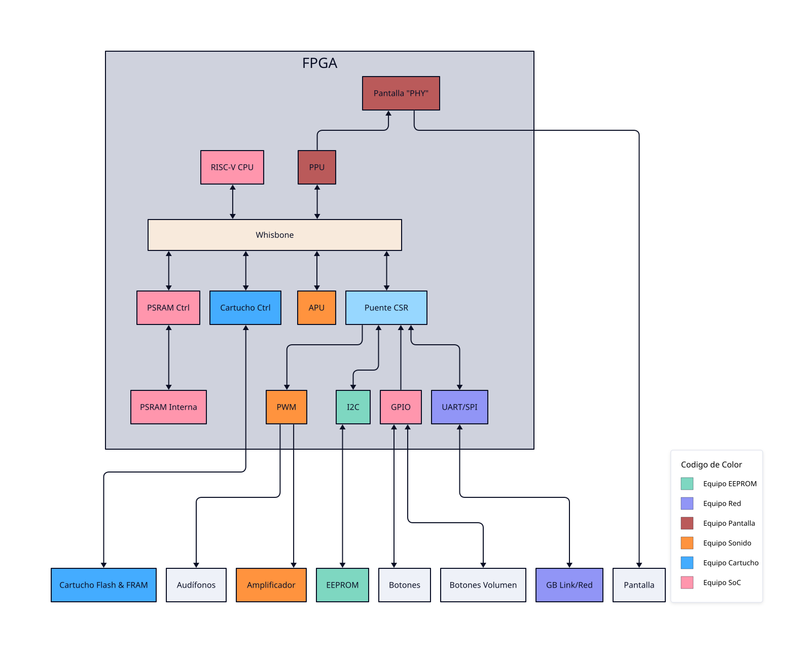
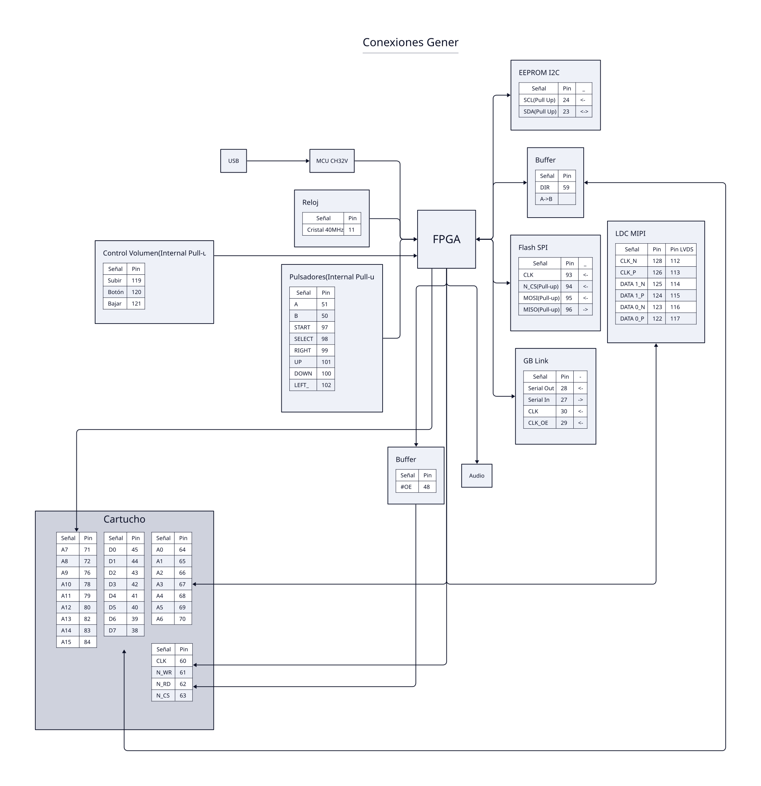

# FPGBC digital UN

Repositorio principal para la ingeniería inversa de la [FPGBC](https://funnyplaying.com/products/fpgbc-kit) y el desarrollo propio en hardware y software.

<details>
<summary><h2>Contenido</h2></summary>

- [Arquitectura Propuesta](#arquitectura-propuesta)
- [Diagrama de conexiones general](#conexiones-general)
- [Herramientas](#herramientas)
    - [Instalación de herramientas](#instalación-de-herramientas)
    - [Uso de herramientas](#uso-de-las-herramientas)
</details>

## Arquitectura propuesta
Se propone una arquitectura inspirada fuertemente por la consola [RISCBoy](https://github.com/Wren6991/RISCBoy) desarrollada por Luke Wren adaptada a herramientas diferentes y lo visto en el curso.


---
## Memoria disponible
### Gowin GW2AR-18
Las FPGAs GW2AR corresponden a la serie Arora II de Gowin, y son la variante con memoria RAM integrada.

En su [datasheet](https://cdn.gowinsemi.com.cn/DS226E.pdf) indica que para la referencia EQ144P se tiene memoria PSRAM de 64 Mbits de capacidad con largo de 16 bits, Gowin ofrece un [modulo IP](https://cdn.gowinsemi.com.cn/IPUG525E.pdf) para el control y acceso a esta memoria

Además dispone de 828Kbits de BSRAM repartidos en 46 bloques/celdas de [18Kbits](https://cdn.gowinsemi.com.cn/UG285E.pdf) que pueden ser usados en diferentes modos.

### [Cartucho](https://github.com/digital-un-2026-2/FPGBC_cartucho)
Según lo encontrado por el Equipo Cartucho se dispone de 8MB en Flash ROM y 128KB en FRAM a los que se accede mediante un Memory Bank Controller.

### [Memoria EEPROM](https://github.com/digital-un-2026-2/FPGBC_eeprom)
Según lo encontrado por el Equipo EEPROM esta memoria tiene una capacidad de 4Kbits con interfaz I2C.

Así, se identifica que la FPGA es quien tiene más memoria, sin embargo, esta no permite almacenamiento permanente que es critico para el almacenamiento de los datos de un juego, por lo tanto esta memoria tiene como propósito el procesamiento interno de imagen, audio y software. Por otro lado la memoria disponible en el cartucho tiene como propósito almacenar el juego, su código y recursos, además de ofrecer memoria RAM extra para las consolas antiguas. Y la memoria EEPROM puede ser util para el almacenamiento de datos no relacionados a los juegos si no al sistema de la consola.

---

## [Soporte para Interrupciones](/soc/femtorv32_intermissum/README.md)


## Conexiones general


### Conexiones por integrado
#### FPGA
#### Memoria Flash
#### [Memoria EEPROM](https://github.com/digital-un-2026-2/FPGBC_eeprom)
#### MCU
#### Convertidores de nivel
#### Amplificador de audio

## Herramientas
Para el proyecto se utilizan las siguientes herramientas
- [Yosys](https://github.com/YosysHQ/yosys)
- [nextpnr](https://github.com/YosysHQ/nextpnr) en su versión para [Gowin](https://www.gowinsemi.com/) (`nextpnr-himbaechel`), compilado localmente en `.nextpnr/` (ya no se usa el paquete de [YoWASP](https://yowasp.org/), ver [PSRAM interna](#psram-interna-y-nextpnr))
- [Project Apicula](https://github.com/YosysHQ/apicula), versión con los pines de la PSRAM interna (`vendor/`)
- [openFPGALoader](https://github.com/trabucayre/openFPGALoader)
- [LiteX](https://github.com/enjoy-digital/litex/)
- [gtkwave](https://github.com/gtkwave/gtkwave)
- [Iverilog](https://github.com/steveicarus/iverilog)
- [RISC-V GNU Compiler Toolchain](https://github.com/riscv-collab/riscv-gnu-toolchain) via [xPack GNU RISC-V Embedded GCC](https://github.com/xpack-dev-tools/riscv-none-elf-gcc-xpack)

### Instalación de Herramientas
Para facilitar la instalación y evitar problemas asociados a rutas y dependencias se utiliza [Pixi](https://pixi.prefix.dev/v0.82.0/)

1. Instalar Pixi con [oneliner](https://pixi.prefix.dev/v0.82.0/installation/)

```bash
curl -fsSL https://pixi.sh/install.sh | sh
```

2. Copiar este repositorio y entrar a la carpeta
```bash
git clone https://github.com/digital-un-2026-2/FPGBC_digital_UN.git
cd FPGBC_digital_UN
```

3. Instalar el espacio de trabajo
```bash
[ FPGBC_digital_UN]$ pixi install
```
4. Configurar el entorno: se descarga el RISC-V toolchain, se compila nextpnr (algunos minutos, requiere `git` y conexión a internet), se pide **autorización** para agregar las reglas udev para acceder al usb, también se añade un comando para activar el entorno desde cualquier lugar[^shellnote]. 
```bash
[ FPGBC_digital_UN]$ pixi run setup-env
```
5. Reinicie o cree otra terminal
6. Probar que se han instalado las herramientas, se ejecuta un ejemplo de LiteX que conlleva compilación de software, síntesis de hardware y intenta subir a una tarjeta 
```bash
[ FPGBC_digital_UN]$ pixi run test-EDA
```


### Uso de las herramientas
Puede utilizar el entorno y sus herramientas mediante comandos propios de pixi `pixi run <comando>` o puede activar el entorno con los siguientes métodos :

- En la carpeta de repositorio `[ FPGBC_digital_UN]$ pixi shell`
- En cualquier lugar `$ FPGBC_workspace_activate`[^shellnote]

[^shellnote]: El comando `FPGBC_workspace_activate` se añadió al archivo ~/.bashrc, si utiliza otro shell puede que no funcione

### PSRAM interna y nextpnr
La PSRAM integrada en el GW2AR-18 (eLQFP144P) se conecta a la FPGA por pines internos que no están en el empaquetado. Apicula (hasta la 0.36) no incluye ese mapeo para este empaquetado, así que el proyecto usa un wheel modificado en `vendor/apycula-0.36+psram-py3-none-any.whl` que añade los 26 pines (`sip_cst["GW2AR-18C"]["eLQFP144P"]`). Con esto nextpnr coloca los puertos `O_psram_*` / `IO_psram_*` en los IOB internos sin necesidad de `IO_LOC`.

- **nextpnr ya no depende de YoWASP**: `yowasp-nextpnr-himbaechel-gowin` trae una chipdb precompilada sin estos pines. En su lugar `nextpnr-0.11.1` se compila contra la apycula del entorno y se instala en `.nextpnr/` (dentro del proyecto), que pixi añade al `PATH`.
- La compilación la hace `pixi run setup-env`. Si cambia apycula, se recompila con:
```bash
[ FPGBC_digital_UN]$ pixi run build-nextpnr
```
  El script detecta si la chipdb está desactualizada; `FORCE=1 pixi run build-nextpnr` fuerza la recompilación.
- Para regenerar el wheel con otra versión de apycula (por ejemplo, descargando el `.whl` desde PyPI):
```bash
[ FPGBC_digital_UN]$ pixi run python scripts/apycula_psram/make_wheel.py apycula-X.Y-py3-none-any.whl vendor
```
  Luego se actualiza la ruta en `pixi.toml` y se ejecuta `pixi install` y `pixi run build-nextpnr`.

## Prueba de SoC mínimo
1. Verificar conexiones físicas
```
cable ft232RL --pins TXD:CTS:DTR:RXD
              --fpga TDI:TDO:TCK:TMS
```
2. Usar el la orden
```bash
[ FPGBC_digital_UN]$ pixi run make -C test/env/min_soc <comando>
```
Con los comandos presentes en el Makefile:
 - sim_cart_calc
 - check_synth
 - build_cart_calc
 - configure_cart_calc
 - load_cart_calc
 - detect


