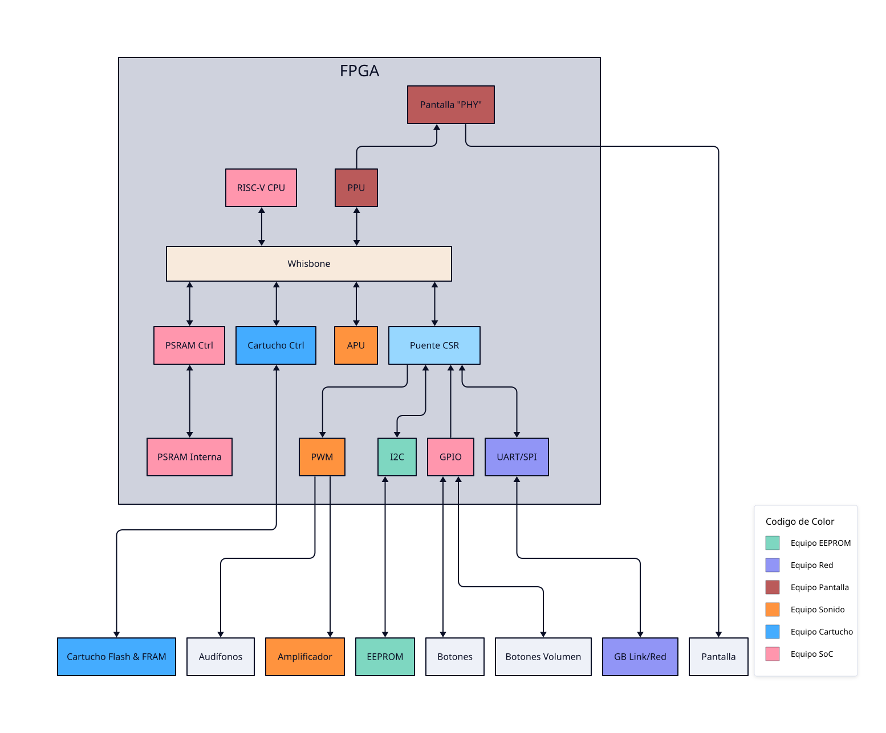

# FPGBC digital UN

Repositorio principal para la ingeniería inversa de la [FPGBC](https://funnyplaying.com/products/fpgbc-kit) y el desarrollo propio en hardware y software.

## Arquitectura propuesta
Se propone una arquitectura inspirada fuertemente por la consola [RISCBoy](https://github.com/Wren6991/RISCBoy) desarrollada por Luke Wren adaptada a herramientas diferentes y lo visto en el curso.



## Diagrama de bloques | Conexiones general


### Conexiones por integrado
#### FPGA
#### Memoria Flash
#### Memoria EEPROM
#### MCU
#### Convertidores de nivel
#### Amplificador de audio

## Herramientas
Para el proyecto se utilizan las siguientes herramientas
- [Yosys](https://github.com/YosysHQ/yosys)
- [nextpnr](https://github.com/YosysHQ/nextpnr) en su versión para [Gowin](https://www.gowinsemi.com/) via [YoWASP](https://yowasp.org/)
- [Project Apicula](https://github.com/YosysHQ/apicula)
- [openFPGALoader](https://github.com/trabucayre/openFPGALoader)
- [LiteX](https://github.com/enjoy-digital/litex/)
- [gtkwave](https://github.com/gtkwave/gtkwave)
- [RISC-V GNU Compiler Toolchain](https://github.com/riscv-collab/riscv-gnu-toolchain) via [xPack GNU RISC-V Embedded GCC](https://github.com/xpack-dev-tools/riscv-none-elf-gcc-xpack)

## Instalación de Herramientas
Para facilitar la instalación y evitar problemas asociados a rutas y dependencias se utiliza [Pixi](https://pixi.prefix.dev/v0.82.0/)

1. Instalar Pixi con [oneliner](https://pixi.prefix.dev/v0.82.0/installation/)

```bash
curl -fsSL https://pixi.sh/install.sh | sh
```

2. Copiar este repositorio y entrar a la carpeta
```bash
git clone https://github.com/digital-un-2026-2/FPGBC_digital_UN.git
cd FPGBC_digital_UN
```

3. Instalar el espacio de trabajo
```bash
[ FPGBC_digital_UN]$ pixi install
```
4. Configurar el entorno, se descarga el RISC-V toolchain y se pide **autorización** para agregar las reglas udev para acceder al usb
```bash
[ FPGBC_digital_UN]$ pixi run setup-env
```
5. Probar que se han instalado las herramientas, se ejecuta un ejemplo de LiteX que conlleva compilación de software, síntesis de hardware y intenta subir a una tarjeta 
```bash
[ FPGBC_digital_UN]$ pixi run test-EDA
```

## Prueba de SoC mínimo
1. Verificar conexiones físicas
```
--cable ft232RL --pins TXD:CTS:DTR:RXD
                --fpga TDI:TDO:TCK:TMS
```
2. Usar el la orden
```bash
[ FPGBC_digital_UN]$ pixi run make -C test/env/min_soc <comando>
```
Con los comandos presentes en el Makefile:
 - sim_irq
 - build_gw2ar_eq144
 - configure_gw2ar_eq144
 - test_gowin
 - detect
 - configure_test


