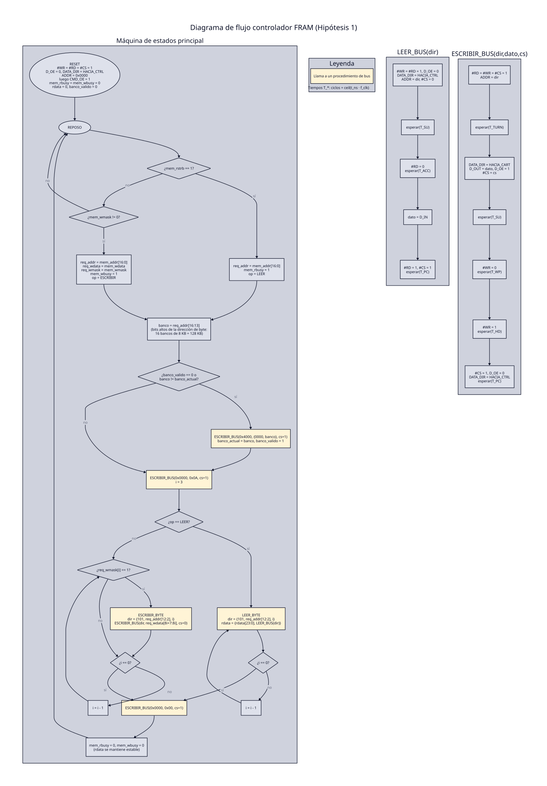
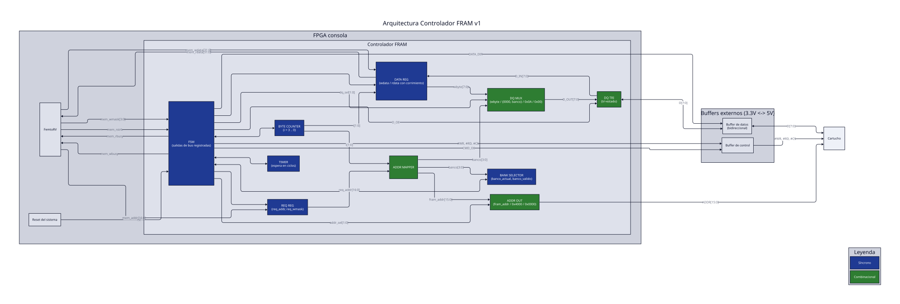
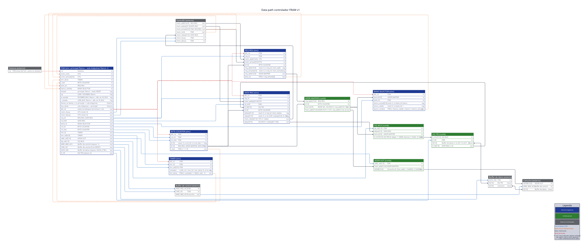
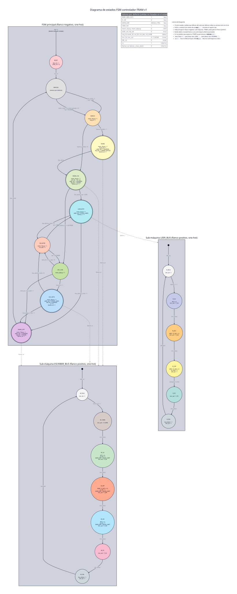

# Controlador para la memoria FRAM FM28V100-TG
A partir de lo encontrado anteriormente respecto a conexiones y revisando el [datasheet de la memoria](https://www.infineon.com/assets/row/public/documents/10/49/infineon-fm28v100-1-mbit-128k-x-8-f-ram-memory-datasheet-en.pdf)[^datasheet] así como un ejemplo de uso desde el lado de software[MBC-5 Memory Controller Specifications, pag. 4](https://es.scribd.com/document/51285034/cgbmbc5)[^datasheet_MBC] se puede concluir lo siguiente.

[^datasheet]: [FM28V100 1-Mbit (128K × 8) F-RAM Memory](https://www.infineon.com/assets/row/public/documents/10/49/infineon-fm28v100-1-mbit-128k-x-8-f-ram-memory-datasheet-en.pdf)

[^datasheet_MBC]: [MBC-5 Memory Controller Specifications](https://es.scribd.com/document/51285034/cgbmbc5)

### Habilitación de la memoria
Para habilitar la memoria y posteriormente realizar operaciones de lectura y escritura se debe seguir el proceso ya consultado por (Rubiano et al.) y evidenciado en [^datasheet_MBC], sea:

1. Establecer el banco de la FRAM mediante la escritura en el registro RAMB del MBC-5
```
D[7:0] = 0x0..0xF : BANK

ADDR[15:0] = 0x4000 -> RAMB REG ADDRESS

#WR = 0 -> Escribe en MBC-5

#CS = 0 -> Selecciona el Cartucho

#RD = 1 -> Lineas de datos de la ROM en alta impedancia
```

Al mismo tiempo, y partiendo que la FRAM no esta habilitada sus señales corresponden a :

```asm
DQ[7:0] = 0xZZ

ADDR[16:0] = {0xX,0x000}

#CE1 = 1
#CE2 = 1 -> Siempre es 1

#WE = #WR = 0

#OE = #RD = 1
```

2. Luego se activa la FRAM, por lo que al cartucho entra 
```asm
D[7:0] = 0x0A : ACTIVATION WORD

ADDR[15:0] = 0x0000 -> RAMG REG ADDRESS

#WR = 0 -> Escribe en MBC-5

#CS = 0 -> Selecciona el Cartucho

#RD = 1 -> Lineas de datos de la ROM en alta impedancia
```

Luego de un tiempo se **puede suponer** que las señales para la FRAM corresponden :

```asm
DQ[7:0] = 0xZZ

ADDR[16:0] = {BANK,0x000}

#CE1 = 1 -> Accionada por MBC-5, bajo hipótesis 1 o 2
#CE2 = 1 -> Siempre es 1

#WE = #WR = 1 -> Cambiada desde consola para evitar escrituras

#OE = #RD = 1
```
Esto corresponde al estado inicial de los ciclos de lectura y escritura descritos en las figuras 5,6 y 7,8 de[^datasheet].
#### Hipótesis 1
Bajo esta teoría, la señal #CE1 de la FRAM cumple con lo siguiente : `Si RAMG==0x0A y #CS0==0 y ADDR[15:12]== (0xA ó 0xB) : #CE1=0` por lo que solo se realizar operaciones cuando se encuentre en este conjunto de direcciones.
#### Hipótesis 2
Sin embargo también es posible que la señal #CE1 cumpla con : `Si RAMG==0x0A : #CE1=0` por lo que las operaciones se podrían realizar incluso cuando no se encuentre en el espacio de memoria asociado y sin conocer el control de habilitación de la ROM puede implicar colisiones si se intenta acceder a la ROM cuando la FRAM esta habilitada, esto se apoya en la indicación de [^datasheet_MBC] "In order to protect RAM data, we recommend that you disable RAM(RAMG = 0x00)" whenever RAM is not being accessed."

Sin embargo, en el esquemático del cartucho `/OE` de la FRAM y de la ROM están conectados ambos a `RD`, por lo que con la Hipótesis 2 una lectura de ROM con la RAM habilitada haría que ambas memorias manejaran el bus de datos al mismo tiempo. La recomendación de [^datasheet_MBC] busca proteger los datos ante escrituras espurias (por ejemplo al apagar), no indica que `#CE1` dependa solo de `RAMG`.

Por lo que se considera un enfoque de acuerdo a **Hipótesis 1**, deshabilitando la RAM (`RAMG = 0x00`) al terminar cada operación. Ver el pseudocódigo en [flow.txt](flow.txt).



### Escritura
Bajo esta hipótesis la escritura se explica mediante la figura 9 [^datasheet] en la que se indican los tiempos requeridos para realizar la operación, cabe resaltar que la escritura tiene prioridad sobre la lectura, por lo que se puede escribir en una dirección y inmediatamente leer.

### Lectura
Bajo esta hipótesis la lectura se explica mediante la figura 4 [^datasheet] en la que se indican los tiempos requeridos para realizar la operación.


Se debe tener en cuenta que el MBC-5 controla la señal de dirección de el buffer de datos de el cartucho y sin conocer este control, si tiene en cuenta la prioridad de la escritura para la FRAM, se asume que solo depende de si la señal es de lectura o de escritura por lo que se considera activar solo alguna de las 2 al realizar las operaciones.

## Arquitectura (v1)


Los bloques en azul son síncronos (contienen registros) y los verdes son combinacionales. El diagrama de arquitectura solo muestra las conexiones principales; el detalle de las entradas y salidas de cada bloque, con quién las produce y quién las recibe, está en el data path:



### Diagrama de estados
La FSM principal recorre la secuencia de habilitación, acceso y deshabilitación; los ciclos de bus se delegan a dos sub-máquinas (`ESCRIBIR_BUS` y `LEER_BUS`) que se activan con `llamar_w` / `llamar_r` y responden con `bus_done`.



Para procesadores RISC-V se utiliza representación en little-endian

## Implementación RTL
La carpeta [`rtl/`](rtl) contiene la implementación en Verilog: un módulo por bloque del data path (`fram_*.v`) y el módulo superior `fram_controller.v`. Los tiempos del bus se ajustan en [`rtl/times.vh`](rtl/times.vh), en ns, junto con la frecuencia del reloj; el TIMER los convierte a ciclos.

- La FSM principal cambia en el flanco negativo; las sub-máquinas `ESCRIBIR_BUS` / `LEER_BUS`, el TIMER y el resto del data path, en el flanco positivo. Todas las salidas de las máquinas de estado son combinacionales según el estado actual.
- Con la macro `BENCH` definida, cada máquina de estados expone el nombre de su estado en ASCII (`state_name`, `w_state_name`, `r_state_name`) para verlo en la forma de onda.

Con el entorno de `FPGBC_digital_UN` activo:

```bash
cd rtl
make sim     # testbench: 3 escrituras y 3 lecturas (reloj de 40 MHz)
make wave    # simulación + gtkwave
make synth   # síntesis de prueba con yosys (synth_gowin, GW2A)
```

